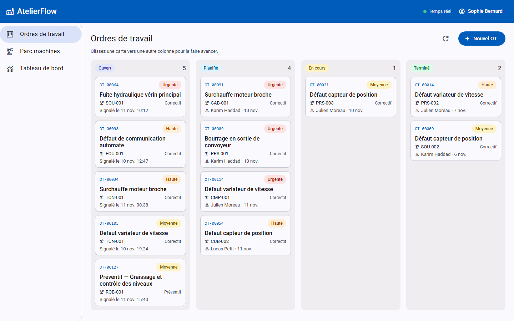
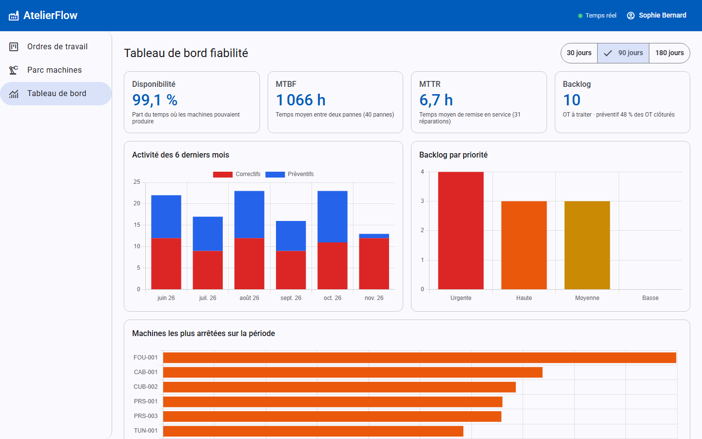
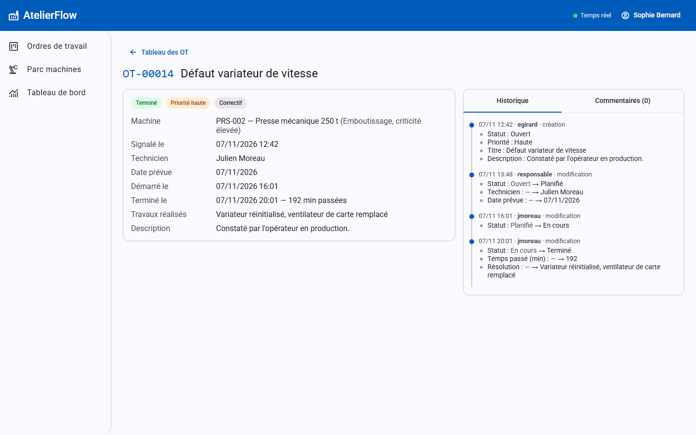
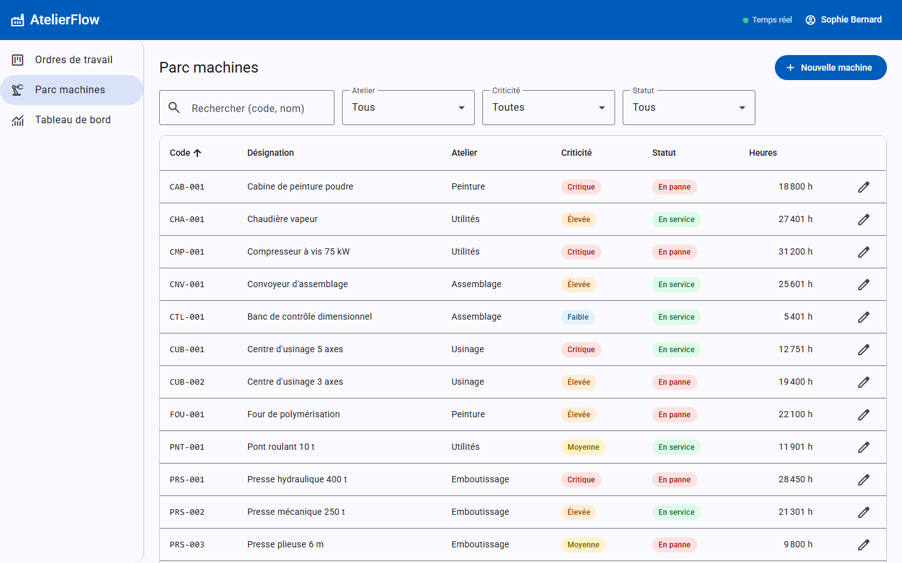
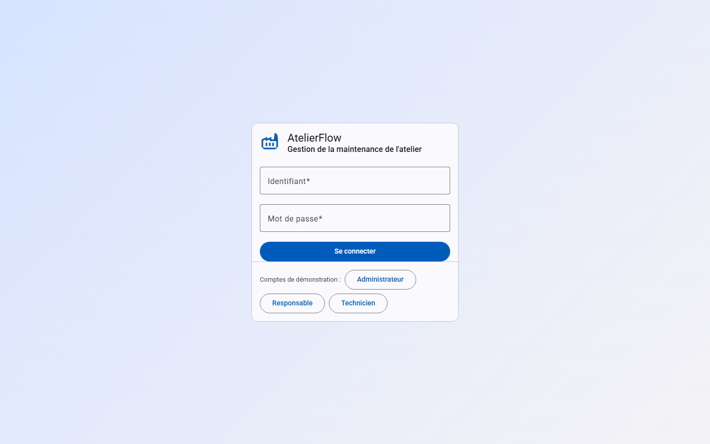

# AtelierFlow — GMAO web pour atelier industriel

[](https://github.com/H-raf0/atelierflow/actions/workflows/ci.yml)


AtelierFlow est une **GMAO** (gestion de maintenance assistée par ordinateur) pour un atelier de production. Elle
permet de gérer :

- le parc machines ;
- les **ordres de travail** (OT), avec un cycle de vie contrôlé ;
- la **maintenance préventive** planifiée ;
- les indicateurs de fiabilité (**MTBF, MTTR, disponibilité**).

Le tableau kanban se met à jour **en temps réel** chez tous les utilisateurs.

C'est un projet personnel. Son but est de montrer une maîtrise professionnelle de la stack Java / Spring Boot /
Angular : de vraies règles métier, de la sécurité, des tests à tous les niveaux et une chaîne CI/CD.



## Lancer la démo (une commande)

Prérequis : Docker (Docker Desktop sous Windows ou macOS).

```bash
git clone https://github.com/H-raf0/atelierflow.git
cd atelierflow
docker compose up --build
```

Ouvrez **http://localhost:8080**. Le premier build prend quelques minutes, le temps de télécharger les
dépendances Maven et npm ; ensuite, `docker compose up` démarre en une vingtaine de secondes.

| Rôle | Identifiant | Mot de passe | Ce qu'il peut faire |
|---|---|---|---|
| Administrateur | `admin` | `Demo-Atelier-2026` | tout, y compris supprimer une machine |
| Responsable maintenance | `responsable` | `Demo-Atelier-2026` | créer, planifier, assigner, annuler des OT ; gérer le parc et les plans préventifs |
| Technicien | `technicien` | `Demo-Atelier-2026` | voir les OT, déclarer une panne, démarrer et terminer **ses** OT, commenter |

La page de connexion propose aussi un bouton par compte pour se connecter en un clic.

Le profil `demo` charge un atelier réaliste :

- 20 machines réparties dans 5 ateliers ;
- environ 120 OT sur six mois, avec leur historique d'audit ;
- des plans préventifs ;
- un **simulateur de télémétrie** qui fait tourner les machines et déclenche des pannes, si bien que le kanban
  vit pendant la démo.

Pour voir le temps réel, ouvrez deux navigateurs (par exemple une fenêtre privée), un en `responsable` et
l'autre en `technicien`.

L'API est documentée et testable dans Swagger UI : http://localhost:8080/swagger-ui.html (bouton *Authorize* :
collez l'`accessToken` renvoyé par `POST /api/auth/login`).

## Fonctionnalités

| Domaine | Détail |
|---|---|
| Parc machines | CRUD, recherche plein texte, filtres (atelier, criticité, statut), tri et pagination côté serveur |
| Ordres de travail | Machine à états `OUVERT → PLANIFIÉ → EN_COURS → TERMINÉ` (+ `ANNULÉ`). Toute transition interdite est refusée avec un **409**. Chaque transition a ses préconditions : technicien assigné, temps passé et résolution obligatoires, motif d'annulation… |
| Statut machine | Dérivé des OT : une panne non réparée met la machine **en panne**, un préventif en cours la met **en maintenance** |
| Maintenance préventive | Plans « tous les N jours » ou « toutes les N heures de fonctionnement » ; une tâche `@Scheduled` idempotente génère les OT, sans doublon |
| Télémétrie simulée | Les machines en service accumulent des heures ; des pannes aléatoires, pondérées par la criticité, ouvrent des OT correctifs |
| Rôles et sécurité | JWT (access 15 min + refresh tournant en cookie HttpOnly), 3 rôles, règles dépendant des données (un technicien n'agit que sur ses OT) |
| Temps réel | WebSocket STOMP authentifié par JWT : le kanban, la fiche OT, le parc et le tableau de bord se mettent à jour en direct |
| Indicateurs | MTBF, MTTR, disponibilité, backlog par priorité, activité mensuelle, machines les plus arrêtées, calculés en SQL agrégé |
| Historique | Audit Hibernate Envers : qui a changé quoi, et quand, sur chaque OT |

| Tableau de bord | Fiche d'un OT avec son historique |
|---|---|
|  |  |

| Parc machines | Connexion |
|---|---|
|  |  |

## Stack technique

- **Backend** : Java 21, Spring Boot 4.1 (Spring Framework 7), Spring Web MVC, Spring Data JPA / Hibernate 7,
  Spring Security (OAuth2 resource server, JWT Nimbus), Spring WebSocket (STOMP), Hibernate Envers, PostgreSQL 17,
  Flyway, MapStruct, Bean Validation, erreurs `ProblemDetail` (RFC 9457), springdoc-openapi, Maven (wrapper).
- **Frontend** : Angular 22 (composants standalone, signals, `resource()`, `linkedSignal`, control flow
  `@if/@for`, **zoneless**), formulaires réactifs typés, Angular Material et CDK (drag & drop), Chart.js
  (ng2-charts), `@stomp/stompjs`, client API **généré** depuis l'OpenAPI (ng-openapi-gen), routes en lazy loading.
- **Qualité** : JUnit 5, AssertJ, Mockito, MockMvc (`MockMvcTester`), **Testcontainers** (vrai PostgreSQL),
  ArchUnit, JaCoCo (seuil bloquant à 80 %), Vitest, **Playwright**.
- **DevOps** : Dockerfiles multi-stage (jar en couches, utilisateur non-root, healthcheck), nginx, Docker
  Compose, GitHub Actions.

## Qualité et tests

Tous les chiffres ci-dessous viennent de la dernière exécution locale :

| Suite | Contenu | Résultat |
|---|---|---|
| Backend (`./mvnw verify`) | unitaires (machine à états : les 25 transitions), intégration MockMvc sur PostgreSQL Testcontainers, autorisations avec de vrais JWT, WebSocket avec un vrai client STOMP, KPI sur un jeu de données calculé à la main, ArchUnit | **176 tests verts**, couverture JaCoCo **97,5 % des lignes**, **84,6 % des branches** |
| Frontend (`npm run test:ci`) | interceptor (refresh puis rejeu), guards, logique du kanban, composants (kanban, fiche OT, parc, dialogues), service STOMP | **64 tests verts**, couverture **80,0 % des lignes** (tout `src/app`, hors client généré) |
| End-to-end (Playwright) | parcours 1 : connexion ; parcours 2 : cycle de vie complet d'un OT sur le kanban, dans deux navigateurs (responsable et technicien) | **6 tests verts** |

Quelques points testés explicitement :

- un technicien ne peut ni planifier, ni assigner, ni annuler, ni modifier le parc
  (`AuthorizationIntegrationTest`) ;
- la réutilisation d'un refresh token volé révoque toutes les sessions de l'utilisateur ;
- lister 10 OT n'exécute **qu'une seule requête SQL**, ce qui prouve l'absence de N+1 ;
- les formules des KPI sont vérifiées sur un jeu de données calculé à la main (`KpiIntegrationTest`).

Lancer les tests :

```bash
cd backend && ./mvnw verify          # nécessite Docker (Testcontainers)
```

```bash
cd frontend && npm ci && npm run test:ci
```

```bash
docker compose up -d --build --wait && cd e2e && npm ci && npx playwright install chromium && npx playwright test --project=e2e
```

## Architecture

Le document [docs/ARCHITECTURE.md](docs/ARCHITECTURE.md) détaille l'architecture avec des diagrammes Mermaid :
composants, modèle de données, machine à états, séquence d'une mise à jour temps réel et sécurité.

```text
atelierflow/
├── backend/     Spring Boot — packages par domaine : equipment, workorder, maintenance, telemetry, kpi, auth, user, realtime, common, demo
├── frontend/    Angular — core/ (auth, temps réel, layout), shared/, features/ (routes lazy), api/ (généré)
├── e2e/         Playwright
├── docs/        ARCHITECTURE.md, captures d'écran
├── deploy/      Caddyfile, script d'installation du serveur
├── docker-compose.yml, docker-compose.prod.yml
└── .github/workflows/ci.yml
```

## Choix techniques justifiés

- **Spring Boot 4.1 plutôt que 3.x** : la branche 3.5 n'a plus de support open source depuis juin 2026. Démarrer
  un projet neuf sur une version en fin de vie aurait été un mauvais signal.
- **Machine à états explicite dans le domaine** : une table de transitions unique, et des méthodes métier
  (`plan`, `start`, `complete`…) plutôt qu'un `PATCH status` générique. Chaque action a sa charge utile, ses
  règles et ses droits. Le serveur expose les transitions possibles, et le kanban ne propose que celles-là.
- **Des DTO partout, jamais d'entité exposée** : des `record` immuables, une conversion générée à la
  compilation par MapStruct (une propriété non mappée fait échouer le build) et des services qui ne renvoient
  que des DTO. Avec `open-in-view: false`, aucune requête paresseuse ne se déclenche depuis la couche web.
- **Erreurs `ProblemDetail` avec un `code` stable** : le frontend traduit le code (`INVALID_TRANSITION`,
  `NOT_ASSIGNEE`…) au lieu d'analyser un message.
- **JWT court en mémoire, refresh token en cookie HttpOnly** : un script injecté (XSS) ne peut pas lire le
  refresh token ; `SameSite=Strict` protège du CSRF les deux seuls endpoints authentifiés par cookie ; la
  rotation et la détection de réutilisation limitent l'impact d'un vol.
- **Événements de domaine publiés après commit** : les services publient des événements Spring, sans rien savoir
  du WebSocket ; le broadcaster les relaie seulement une fois la transaction validée.
- **KPI en SQL agrégé** (`FILTER`, `LEAST/GREATEST`) plutôt qu'un calcul en Java sur des entités chargées :
  une requête par indicateur, quel que soit le volume. Les formules sont documentées dans `KpiService`.
- **Testcontainers plutôt que H2** : les tests tournent sur le même PostgreSQL qu'en production (types
  `timestamptz`, contraintes `CHECK`, fonctions SQL).
- **Signals pour l'état, RxJS pour les flux d'événements** : les données affichées sont des signals
  (`resource()`, `computed`), les messages WebSocket des `Observable`.
- **Client API généré** : le contrat OpenAPI est exporté par un test backend, le client TypeScript en est
  généré, et la CI vérifie qu'ils restent synchronisés.

## Déploiement

L'application se déploie gratuitement sur une VM Oracle Cloud *Always Free* : le même `docker compose`, plus
Caddy pour le HTTPS automatique (`docker-compose.prod.yml`). Le guide [docs/DEPLOIEMENT.md](docs/DEPLOIEMENT.md)
détaille la marche à suivre, et le script `deploy/install.sh` installe tout en une commande sur le serveur.

## Configuration

| Variable | Rôle | Démo (`docker-compose.yml`) |
|---|---|---|
| `JWT_SECRET` | clé HMAC des JWT, en Base64, au moins 256 bits ; **obligatoire** hors profil démo | clé de démonstration uniquement |
| `DB_URL`, `DB_USER`, `DB_PASSWORD` | connexion PostgreSQL | base du conteneur `postgres` |
| `POSTGRES_PASSWORD` | mot de passe PostgreSQL (compose) | `atelierflow-demo` |
| `CORS_ALLOWED_ORIGINS` | origines autorisées si la SPA est servie ailleurs | vide (même origine) |
| `REFRESH_COOKIE_SECURE` | cookie `Secure` (HTTPS) | `false` en démo (HTTP local) |

Les valeurs de démonstration ne servent qu'au profil `demo`. Pour tout autre usage, générez une clé, par
exemple avec `openssl rand -base64 48`, et passez-la dans `JWT_SECRET`.

## Développement local

Backend sur un PostgreSQL éphémère démarré par Testcontainers (Docker requis), avec les données de démo :

```bash
cd backend && ./mvnw spring-boot:test-run -Dspring-boot.run.profiles=demo
```

Frontend avec rechargement à chaud (http://localhost:4200, `/api` et `/ws` relayés vers le port 8080) :

```bash
cd frontend && npm start
```

Ce mode utilise les réglages de test (`src/test/resources/config/application.properties`) : clé JWT de test et
tâches planifiées désactivées. Arrêtez d'abord `docker compose`, qui occupe aussi le port 8080.

Après une modification de l'API, régénérez le client :

```bash
cd backend && ./mvnw test -Dtest=AtelierflowApplicationTests && cp target/openapi.json ../frontend/ && cd ../frontend && npm run generate:api
```
