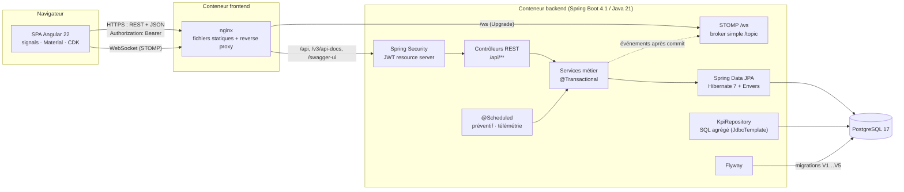
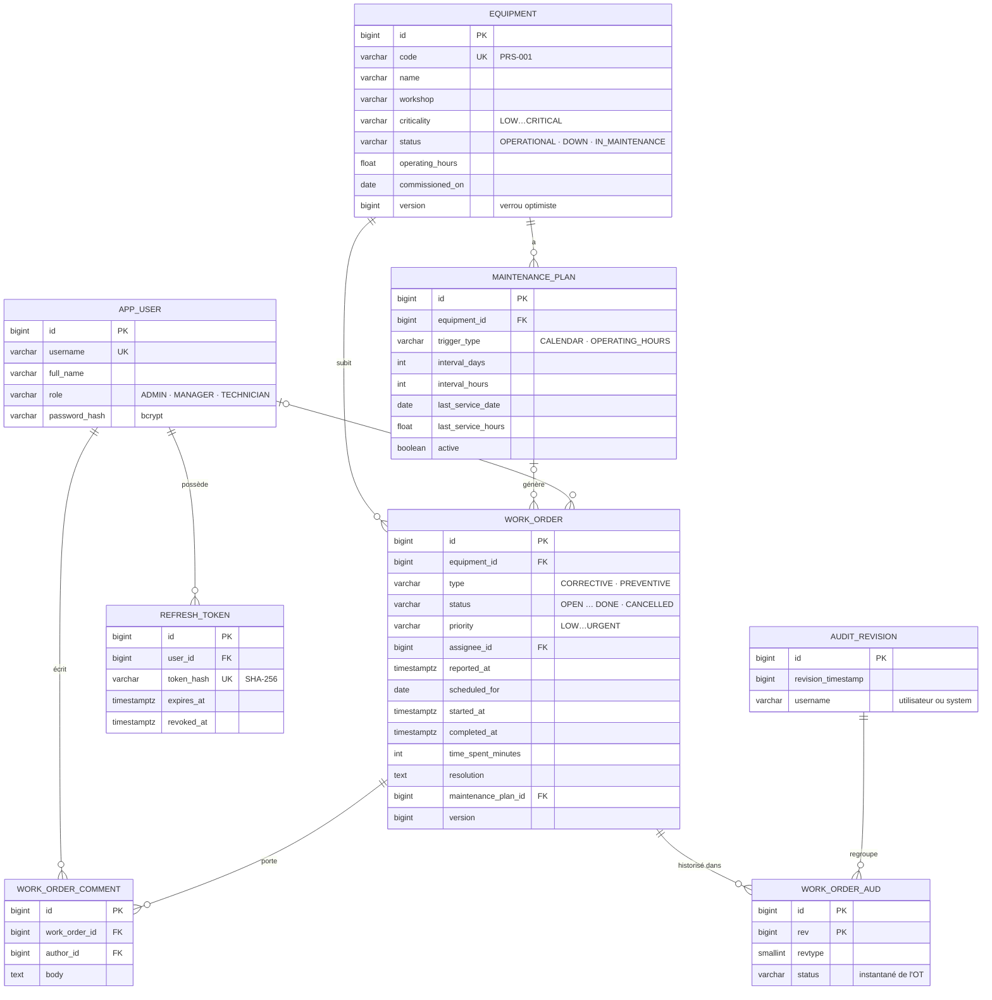
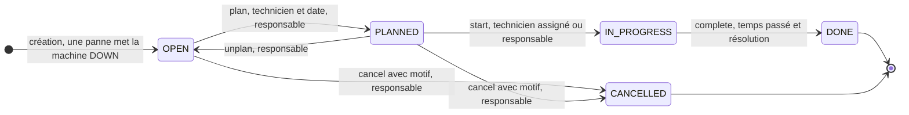
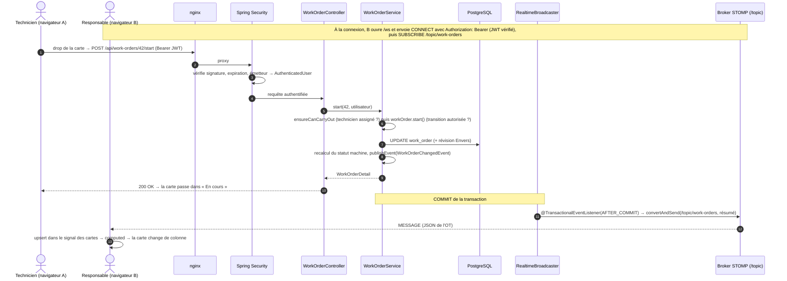

# Architecture d'AtelierFlow

Ce document décrit l'organisation technique de l'application : composants, modèle de données, cycle de vie
d'un ordre de travail (OT) et circulation d'une mise à jour en temps réel.

## 1. Vue d'ensemble des composants



**Principes**

- **Même origine** : nginx sert la SPA et relaie l'API et le WebSocket sur `http://localhost:8080`. Il n'y a donc
  pas de CORS à configurer, et le cookie de rafraîchissement (`SameSite=Strict`) fonctionne sans réglage
  particulier.
- **API sans état** : chaque requête porte un JWT d'accès de 15 minutes, et aucun état de session n'est
  conservé côté serveur.
- **Le schéma appartient à Flyway** ; Hibernate se contente de le valider (`ddl-auto: validate`).
- **Contrat OpenAPI** : il est généré à partir du code (springdoc), exporté par un test, puis utilisé pour
  générer le client TypeScript (`ng-openapi-gen`). La CI échoue si le contrat et le client divergent.

### Organisation du code backend (packages par domaine)

```text
dev.atelierflow
├── common/        erreurs ProblemDetail, BaseEntity, pagination, Clock, audit (révision Envers), OpenAPI
├── equipment/     parc machines (entité, dépôt, spécifications de recherche, service, contrôleur, dto/)
├── user/          utilisateurs et rôles
├── auth/          JWT (émission/validation), refresh tokens, SecurityConfig, @ManagerOrAdmin / @AdminOnly
├── workorder/     ordres de travail : machine à états, commentaires, historique Envers
├── maintenance/   plans de maintenance préventive + tâche @Scheduled
├── telemetry/     simulateur de télémétrie (heures de fonctionnement, pannes)
├── kpi/           indicateurs MTBF / MTTR / disponibilité / backlog
├── realtime/      configuration STOMP, authentification des trames, diffusion des événements
└── demo/          jeu de données de démonstration (profil « demo »)
```

Chaque domaine suit les mêmes couches : contrôleur → service → dépôt. Des règles **ArchUnit**, vérifiées à
chaque build, garantissent que :

- les contrôleurs n'accèdent pas directement aux dépôts ;
- aucune entité JPA n'est exposée par l'API ;
- les DTO sont des `record` rangés dans des packages `dto` ;
- il n'existe aucun cycle entre domaines.

Les dépendances entre domaines vont toujours dans le même sens :
`maintenance → workorder → equipment`, `telemetry → workorder`, `realtime → workorder`.
Le plan d'origine d'un OT est donc stocké sous forme d'identifiant simple, pour ne pas créer de cycle.

### Organisation du code frontend

```text
src/app
├── api/        client généré depuis l'OpenAPI (ne pas modifier à la main)
├── core/       auth (service à signals, interceptor, guards), temps réel (STOMP), layout, notifications
├── shared/     libellés français, traduction des erreurs ProblemDetail, dates, paginateur
└── features/   login · equipment · work-orders (kanban, fiche, dialogues) · dashboard   ← routes lazy
```

## 2. Modèle de données



La base de données revérifie elle-même les invariants : des contraintes `CHECK` interdisent par exemple un OT
planifié sans technicien, un OT terminé sans temps passé ni résolution, ou une date de fin antérieure à la date
de début. Une clé étrangère `ON DELETE RESTRICT` empêche aussi de supprimer une machine qui a un historique.

## 3. Machine à états d'un ordre de travail



- La table de transitions de `WorkOrderStatus` est la **seule source de vérité**. Les méthodes métier de
  `WorkOrder` (`plan`, `start`…) la consultent avant de modifier quoi que ce soit.
- Une transition interdite lève `InvalidTransitionException`, que l'API renvoie en **409 Conflict** avec le code
  `INVALID_TRANSITION`.
- Un travail commencé ne peut pas être annulé : il doit être terminé, avec son temps passé.
- L'API expose `allowedTransitions` pour chaque OT : le kanban s'en sert pour n'accepter que les déplacements
  autorisés, sans dupliquer les règles dans le frontend.
- Le **statut de la machine** est recalculé après chaque changement :
  - `DOWN` si un OT correctif est actif ;
  - `IN_MAINTENANCE` si un OT préventif est en cours ;
  - `OPERATIONAL` sinon.
- Les 25 couples (statut de départ, statut d'arrivée) sont testés de façon exhaustive
  (`WorkOrderStateMachineTest`).

## 4. Séquence d'une mise à jour en temps réel

Exemple : le technicien démarre un OT depuis le kanban, et le responsable voit la carte changer de colonne sans
recharger la page.



L'événement n'est diffusé **qu'après le commit**. Un client n'est donc jamais prévenu d'un changement qui serait
ensuite annulé, et s'il recharge les données en réaction, il les trouve bien à jour.

Avec plusieurs instances du backend, le broker en mémoire serait remplacé par un relais vers RabbitMQ ou
ActiveMQ (`enableStompBrokerRelay`), pour que chaque instance reçoive tous les messages.

## 5. Sécurité

| Élément | Choix |
|---|---|
| Authentification | `POST /api/auth/login` → mot de passe vérifié par `DaoAuthenticationProvider` + BCrypt |
| Jeton d'accès | JWT HS256 de 15 min, conservé **en mémoire** par la SPA, envoyé en `Authorization: Bearer` |
| Jeton de rafraîchissement | aléatoire (256 bits), cookie `HttpOnly; SameSite=Strict; Path=/api/auth`, stocké **haché** (SHA-256), **rotation** à chaque usage, **réutilisation détectée** → révocation de toutes les sessions de l'utilisateur |
| Clé de signature | variable d'environnement `JWT_SECRET` (≥ 256 bits), démarrage refusé sans elle ; clé de démo uniquement dans le profil `demo` |
| Autorisations | `@ManagerOrAdmin`, `@AdminOnly` (`@PreAuthorize`) + règles dépendant des données dans les services (un technicien n'agit que sur ses OT) |
| WebSocket | handshake public, JWT exigé dans la trame STOMP `CONNECT`, publication sur `/topic` interdite aux clients |
| Erreurs | 401/403 renvoyées au format `ProblemDetail`, comme toutes les autres erreurs |
